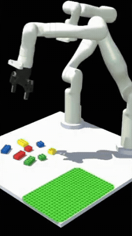
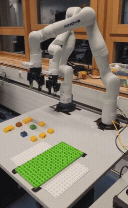
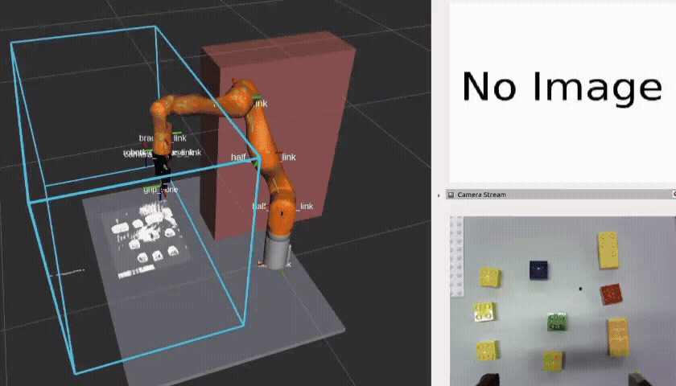

# `kinova_lego_assembly`

A modular ROS 2 system that maintains a catalog of LEGO blueprints, receives a target model name at runtime, perceives the blocks in the workspace, and assembles the model on the LEGO holder with collision-aware motion. Validated in MuJoCo simulation, then deployed on the physical Kinova Gen3 arm.

<p align="center">
  
  &nbsp;
  
  &nbsp;
  
</p>
<p align="center"><em><code>e_stop</code>: MuJoCo simulation (left), real robot (middle), and RViz with camera stream (right).</em></p>

---

## Packages

| Package                                                                  | Role                                                                                        |
| ------------------------------------------------------------------------ | ------------------------------------------------------------------------------------------- |
| [`kinova_lego_assembly`](src/kinova_lego_assembly)                       | Perception, blueprints, and assembly orchestration ([tests](src/kinova_lego_assembly/README.md#tests)) |
| [`kinova_lego_assembly_interfaces`](src/kinova_lego_assembly_interfaces) | Messages, services, and actions                                                             |
| [`kinova_mujoco_sim`](src/kinova_mujoco_sim)                             | Optional MuJoCo simulation and its MoveIt config ([README](src/kinova_mujoco_sim/README.md)) |

---

## Getting started

Steps 1 to 4 install the main application. Then pick how to run it:

- [Option A: Real robot](#option-a-real-robot) on a Kinova Gen3 with the
  Kortex driver, MoveIt, and the vision module.
- [Option B: Simulation](#option-b-simulation) in MuJoCo, no hardware needed.

### Prerequisites

| Requirement | Version          |
| ----------- | ---------------- |
| Ubuntu      | 22.04 LTS        |
| ROS 2       | Humble Hawksbill |
| Python      | 3.10             |

### 1. Create a workspace and clone the repositories

`mas_industrial_robotics` provides `mir_interfaces` and the MMOR object
recognition used by the orchestrator.

```bash
mkdir -p ~/kinova_lego_assembly_ws/src
cd ~/kinova_lego_assembly_ws/src
git clone git@github.com:a2s-institute/kinova_lego_assembly.git
git clone git@github.com:Jay-droid/mas_industrial_robotics.git

# Return to the workspace root and set up a venv that can access ROS packages.
cd ~/kinova_lego_assembly_ws
sudo apt update
sudo apt install -y python3-venv python3-vcstool python3-rosdep
sudo rosdep init  # skip if rosdep was initialised before
rosdep update

source /opt/ros/humble/setup.bash
python3 -m venv --system-site-packages venv
touch venv/COLCON_IGNORE
source venv/bin/activate
```

### 2. Install dependencies

From the workspace root, with the venv active:

```bash
python3 -m pip install -r src/kinova_lego_assembly/src/kinova_lego_assembly/requirements.txt
# optional: test and lint tools
python3 -m pip install -r src/kinova_lego_assembly/src/kinova_lego_assembly/requirements.dev.txt

rosdep install --ignore-src -y --from-paths \
  src/kinova_lego_assembly/src/kinova_lego_assembly \
  src/kinova_lego_assembly/src/kinova_lego_assembly_interfaces \
  src/mas_industrial_robotics
```

`kinova_mujoco_sim` is left out on purpose; its dependencies are covered by the
simulation guide.

### 3. Download trained models

Model weights are not tracked in git. Download the latest bundle from
[this OneDrive folder](https://studhbrsde-my.sharepoint.com/:f:/g/personal/scotrraaj_gopal_smail_inf_h-brs_de/IgBjYcjkEeCuRKjxh-8T2YHeAdhgZvkcBIdpvcioWX8hLjs?e=ai2MSA)
and extract it into
[`src/kinova_lego_assembly/trained_models/`](src/kinova_lego_assembly/trained_models)
so the layout matches its [README](src/kinova_lego_assembly/trained_models/README.md).

The registry picks the highest available `v<N>` directory by default;
override with the `segmentation.model_version` parameter.

### 4. Build

```bash
python3 -m colcon build --packages-up-to kinova_lego_assembly
source install/setup.bash
```

`launch_assembly.launch.py` starts the assembly pipeline in order:
the segmentation service, MMOR object recognition and its lifecycle manager,
the planning-scene obstacle publisher, and the task orchestrator. It also
starts the task RViz view and waits for perception and motion-planning
dependencies before executing the assembly behavior. List all launch
arguments with `-s`.

### Option A: Real robot

On the real robot the orchestrator expects the Kortex driver with MoveIt and
the vision module to be running already. Both come from Kinova and live in
their own workspace, built without this project's venv.

#### A1. Create the Kortex workspace

```bash
sudo apt install -y python3-colcon-common-extensions python3-vcstool
mkdir -p ~/kinova_kortex_ws/src
```

#### A2. Build `ros2_kortex`

Driver, robot description, and MoveIt config for the Gen3. See the
[`ros2_kortex` README](https://github.com/Kinovarobotics/ros2_kortex/tree/humble#readme)
for more information.

```bash
source /opt/ros/humble/setup.bash
cd ~/kinova_kortex_ws
git clone -b humble --single-branch https://github.com/Kinovarobotics/ros2_kortex.git src/ros2_kortex
vcs import src --skip-existing --input src/ros2_kortex/ros2_kortex.$ROS_DISTRO.repos
vcs import src --skip-existing --input src/ros2_kortex/ros2_kortex-not-released.$ROS_DISTRO.repos

rosdep install --ignore-src --from-paths src -y -r
colcon build --cmake-args -DCMAKE_BUILD_TYPE=Release --parallel-workers 3
```

#### A3. Build `ros2_kortex_vision`

Colour and depth streams from the arm's vision module. See the
[`ros2_kortex_vision` README](https://github.com/Kinovarobotics/ros2_kortex_vision#readme)
for more information.

```bash
sudo apt install -y gstreamer1.0-tools gstreamer1.0-libav libgstreamer1.0-dev \
  libgstreamer-plugins-base1.0-dev libgstreamer-plugins-good1.0-dev \
  gstreamer1.0-plugins-good gstreamer1.0-plugins-base ros-humble-depth-image-proc

cd ~/kinova_kortex_ws
git clone https://github.com/Kinovarobotics/ros2_kortex_vision.git src/ros2_kortex_vision
rosdep install --ignore-src --from-paths src/ros2_kortex_vision -y -r
colcon build --packages-select kinova_vision
```

#### A4. Launch

Use one terminal per command, in this order:

```bash
# Terminal 1: robot driver + MoveIt
source ~/kinova_kortex_ws/install/setup.bash
ros2 launch kinova_gen3_7dof_robotiq_2f_85_moveit_config robot.launch.py robot_ip:=192.168.1.10

# Terminal 2: vision module (colour, registered depth, point cloud)
source ~/kinova_kortex_ws/install/setup.bash
ros2 launch kinova_vision kinova_vision.launch.py depth_registration:=true

# Terminal 3: assembly pipeline
cd ~/kinova_lego_assembly_ws
source install/setup.bash
source venv/bin/activate
ros2 launch kinova_lego_assembly launch_assembly.launch.py
```

`192.168.1.10` is the arm's factory IP; change it if yours was reassigned.

### Option B: Simulation

Follow the [`kinova_mujoco_sim` installation guide](src/kinova_mujoco_sim/README.md#installation)
to build the simulator, then:

```bash
ros2 launch kinova_lego_assembly launch_assembly.launch.py sim_mode:=true
```

This also brings up the simulator and MoveIt, and `use_sim_time` follows
`sim_mode` automatically.

### Segmentation only

`launch_segmentation.launch.py` starts only the `LegoSegmentation`
service node, which provides `~/segment_image`:

```bash
ros2 launch kinova_lego_assembly launch_segmentation.launch.py
```

Tune segmentation inference parameters through ROS parameters (see
[`config/params.yml`](src/kinova_lego_assembly/config/params.yml)), for example:

```bash
ros2 param set /LegoSegmentation segmentation.yolo.conf 0.7
```
